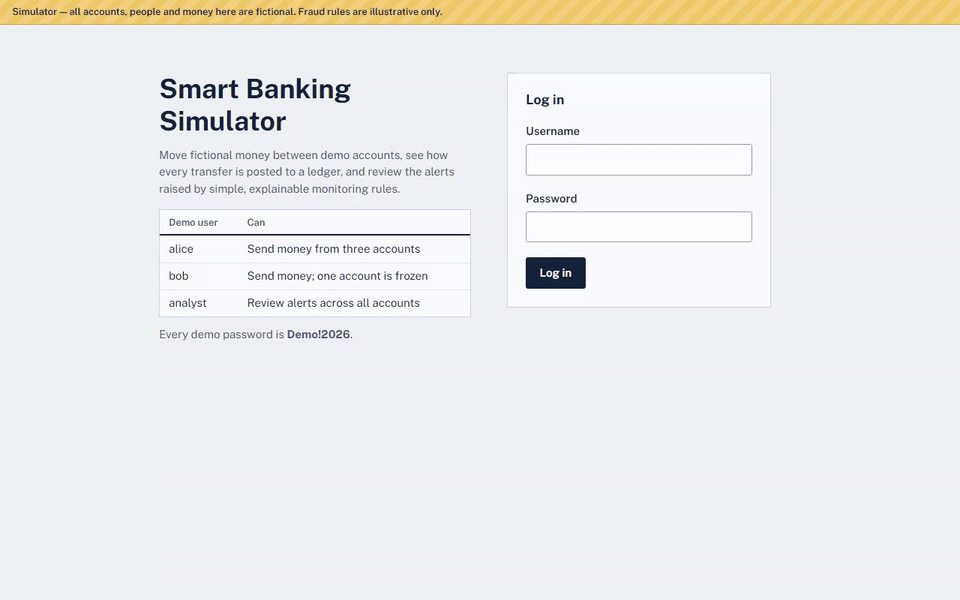
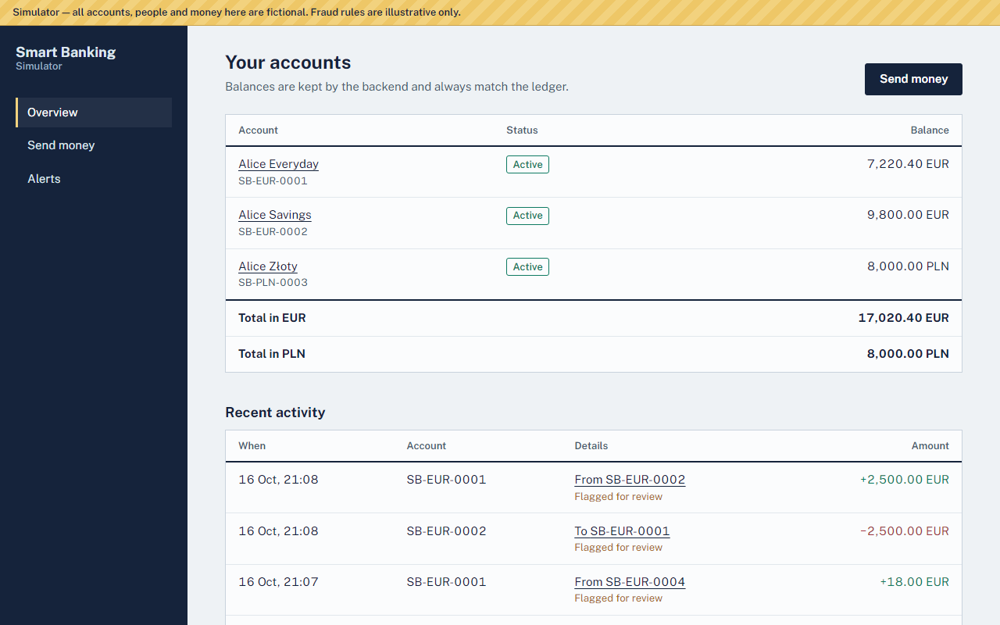
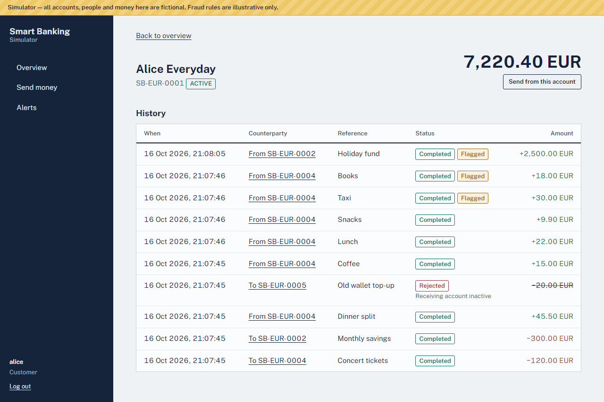
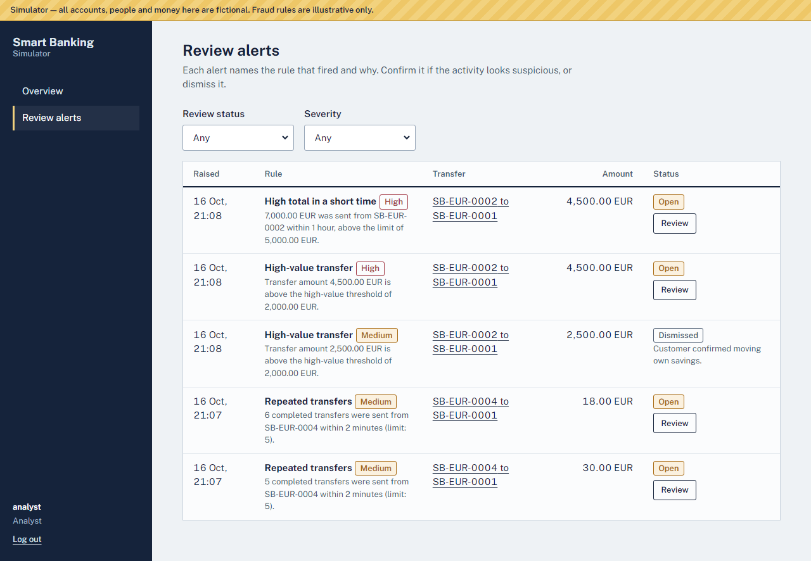
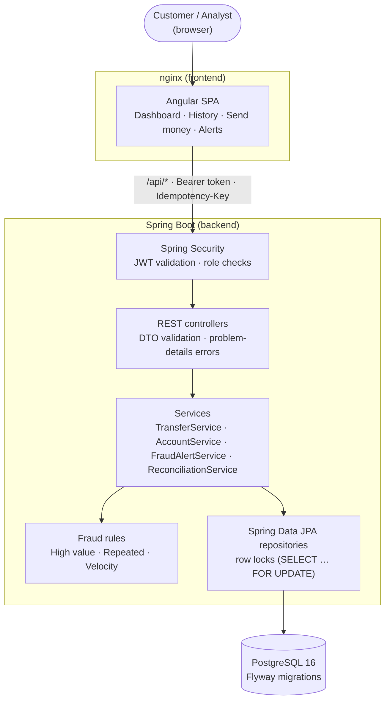
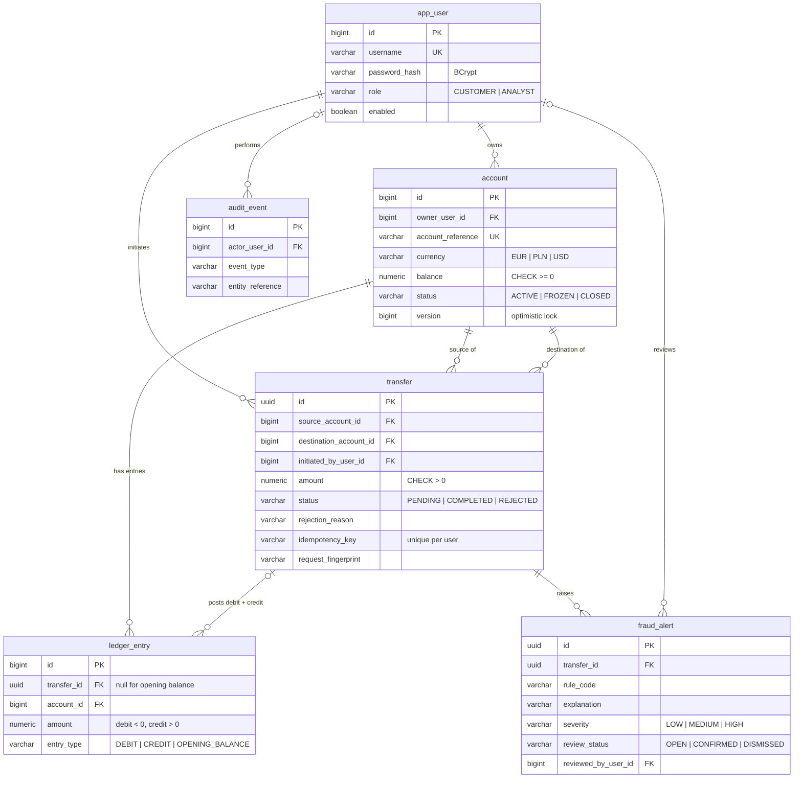

# Smart Banking Simulator

[](https://github.com/sutharv/smart-banking/actions/workflows/ci.yml)

A full-stack banking simulator: customers view fictional accounts, transfer fictional money, and inspect their history; an analyst reviews suspicious-activity alerts raised by simple, explainable rules.

The point of the project is to show how a reliable financial application validates requests, protects data, keeps the database consistent under concurrency, and proves all of that with automated tests.

> **This is a learning simulator, not a bank.** All accounts, people and money are fictional, credentials are local demo credentials, and the fraud rules are illustrative — they are not production-grade fraud detection.

## Demo

A 2,500 EUR transfer goes through, the high-value rule flags it, and an analyst reviews and dismisses the alert with a note.



## Screenshots

| Dashboard | Transfer history |
|---|---|
|  |  |
| Balances per account and currency, with recent activity and flagged transfers. | Completed, flagged and rejected transfers; a rejected attempt keeps its reason. |

**Fraud-alert queue (analyst view)**



Every alert names the rule that fired, its severity, and the exact numbers behind it. Analysts confirm or dismiss each alert once, with an optional note.

## My contributions

I designed and built the whole project: the domain model, backend, frontend, tests and delivery pipeline.

- **Transfer engine.** Single-transaction transfers with ordered pessimistic row locks, a double-entry ledger, idempotency keys and recorded rejections. A concurrency test proves there's no double spending and no deadlocks.
- **Data integrity in the database itself.** Flyway schema with `CHECK` constraints (no negative balances, valid state combinations), unique idempotency keys, and a trigger that makes ledger rows immutable.
- **Fraud monitoring.** A pluggable `FraudRule` interface with three configurable, explainable rules, plus an analyst review workflow.
- **Security.** Stateless JWT auth, role-based access, ownership checks in the service layer, `404` instead of `403` for other customers' accounts, RFC 9457 error responses and an audit trail.
- **Angular frontend.** Standalone components with signals, typed API services, form validation, and idempotency-key reuse on retry.
- **Quality and delivery.** Unit, MockMvc, Testcontainers and concurrency tests, Vitest frontend tests, GitHub Actions CI, and a one-command Docker Compose environment.

| Decision | Why |
|---|---|
| Pessimistic locks in ascending id order | Hot accounts would cause retry storms under optimistic locking; a fixed lock order rules out A→B / B→A deadlocks. |
| Double-entry, append-only ledger | Balances can always be reconciled (`balance = SUM(entries)`), and history can't be silently rewritten. |
| Flag, don't block | Rules are heuristics: a flagged transfer still completes and goes to a human, so false positives don't stop customers. |
| Record rejected attempts | Failed transfers stay auditable and visible to the sender, with a reason. |
| Idempotency keys | Retries after network errors never move money twice. |

The full reasoning is in [Key design decisions](#key-design-decisions).

## Stack

| Layer | Technology |
|---|---|
| Backend | Java 21, Spring Boot 3.5, Spring Web, Spring Security (JWT resource server), Spring Data JPA / Hibernate |
| Database | PostgreSQL 16, Flyway migrations |
| Frontend | Angular 21 (standalone components, signals), TypeScript, reactive forms |
| API docs | springdoc-openapi / Swagger UI |
| Tests | JUnit 5, Mockito, MockMvc, Testcontainers (PostgreSQL); Vitest for Angular |
| CI | GitHub Actions |
| Local environment | Docker Compose |

## Quick start (Docker)

Requires Docker with Compose.

```bash
docker compose up --build
```

- App: http://localhost:4200
- API docs: http://localhost:8080/swagger-ui.html
- Health: http://localhost:8080/actuator/health

### Demo users

Every password is `Demo!2026`.

| User | Role | What to try |
|---|---|---|
| `alice` | Customer | Three accounts (two EUR, one PLN). Send 2,500 EUR from Savings to see a high-value alert; send five small transfers quickly to trigger the repeated-transfers rule. |
| `bob` | Customer | One active account and one frozen account (transfers to or from it are rejected). |
| `analyst` | Analyst | Read-only view of all accounts; reviews alerts (confirm or dismiss). |

## Local development

**Prerequisites:** JDK 21, Maven 3.9+, Node.js 22.12+ (or 24), Docker (for the database and integration tests).

```bash
# 1. Database
docker compose up -d db

# 2. Backend on :8080 — the "demo" profile loads the demo users and accounts
cd backend
DB_PASSWORD=smartbanking mvn spring-boot:run -Dspring-boot.run.profiles=demo

# 3. Frontend on :4200 — proxies /api to :8080 (see proxy.conf.json)
cd frontend
npm ci
npm start
```

### Configuration

| Variable | Purpose | Default |
|---|---|---|
| `DB_URL` | JDBC URL | `jdbc:postgresql://localhost:5432/smartbanking` |
| `DB_USERNAME` / `DB_PASSWORD` | Database credentials | `smartbanking` / *(none; `smartbanking` in the demo profile)* |
| `JWT_SECRET` | HS256 signing secret, at least 32 characters. **Required** outside the demo profile — the app refuses to start without it. | *(demo profile only)* |
| `CORS_ALLOWED_ORIGINS` | Comma-separated browser origins | `http://localhost:4200` |
| `SPRING_PROFILES_ACTIVE` | `demo` loads fictional seed data | *(none)* |

Fraud-rule thresholds and windows live in `backend/src/main/resources/application.yml` under `app.fraud`.

## Running the tests

```bash
cd backend && mvn verify      # unit tests + integration tests (needs Docker for Testcontainers)
cd frontend && npm test       # Angular unit tests (Vitest)
```

Integration tests are skipped automatically when Docker is unavailable; CI always runs them.

| Level | What is covered |
|---|---|
| Backend unit | Each fraud rule (thresholds, inclusive window boundaries, other accounts ignored), domain invariants (no negative balance, PENDING → COMPLETED/REJECTED only, ledger sums to zero, alerts reviewed once), transfer service (lock ordering, rejection without side effects, idempotent replay and conflict) |
| Backend integration | Full HTTP + security + real PostgreSQL: login and token handling, account visibility per user, pagination, every validation and rejection path, idempotent retries, fraud alerts end to end, alert review permissions, reconciliation, immutable ledger trigger |
| Concurrency | 10 simultaneous 1,000 EUR transfers from a 5,000 EUR account: exactly 5 complete, 5 are rejected, the balance ends at 0; 30 opposing transfers between two accounts finish without deadlock or lost updates; the ledger reconciles afterwards |
| Frontend unit | API error mapping, money formatting, session storage and expiry, auth interceptor (token only on API calls, logout on 401), transfer form validation and payload, idempotency key reuse on retry and renewal on change, rejection display, alert review flow per role |

## Architecture



Backend packages: `controller`, `dto`, `service`, `repository`, `entity`, `fraud`, `security`, `exception`, `config`.

The backend is the only authority on balances, transfer validity and permissions. The frontend validates for convenience, then shows whatever the backend decides.

## Key design decisions

### Transfers are atomic

`TransferService.createTransfer` runs in a single database transaction:

1. Validate the request (amount > 0, at most 2 decimals, different accounts).
2. Authorise: the caller must own the source account.
3. Lock both account rows with `SELECT … FOR UPDATE`, **always in ascending id order**.
4. Check status, currency and funds against the locked, current rows.
5. Write the transfer, a debit and a credit ledger entry, and update both balances.
6. Evaluate fraud rules and store alerts; write the audit record.
7. Commit.

Any failure rolls everything back, so there is never a debit without a credit.

**Why pessimistic locking?** Money movement on a single hot account is exactly where optimistic locking produces retry storms. Row locks serialise transfers touching the same account (no double spending), and the fixed lock order prevents deadlocks between A→B and B→A. Accounts also carry a `@Version` column as a second line of defence, and the database rejects negative balances with a `CHECK` constraint.

The account reference is first resolved to an id with a projection query, so the locking read is the first time the entity enters the persistence context and its state is guaranteed fresh.

### Ledger and balances

Every completed transfer posts two immutable `ledger_entry` rows: a negative debit and a positive credit that sum to zero. Opening balances are posted as `OPENING_BALANCE` entries, so for every account `balance = SUM(ledger_entry.amount)`. A database trigger blocks `UPDATE` and `DELETE` on ledger rows; corrections must be new reversing entries. `GET /api/reconciliation` (analysts) checks both invariants.

Money is `BigDecimal` in Java and `NUMERIC(19,2)` in PostgreSQL. Timestamps are `TIMESTAMPTZ`, written as UTC instants from an injectable `Clock`.

### Rejected attempts are recorded

A well-formed request that fails a business rule (insufficient funds, inactive account, currency mismatch) is stored with status `REJECTED` and a reason, and the API answers `422` with the transfer id. Malformed requests (`400`) and unauthorised ones (`404`) are not stored. Rejected attempts appear in the sender's history but not the recipient's.

### Idempotent retries

Clients may send an `Idempotency-Key` header. A repeat with the same key and the same request returns the original outcome (`Idempotent-Replayed: true`) without moving money again; the same key with a different request is a `409`. The frontend generates one key per distinct form submission and keeps it across retries after network errors.

### Fraud monitoring: flag, don't block

| Rule | Code | Default (illustrative) | Severity |
|---|---|---|---|
| High-value transfer | `HIGH_VALUE_TRANSFER` | Amount above 2,000 EUR / 8,500 PLN / 2,200 USD | Medium; High above twice the threshold |
| Repeated transfers | `RAPID_REPEATED_TRANSFERS` | 5 or more completed transfers from one account within 2 minutes | Medium |
| High total in a short time | `HIGH_VELOCITY_AMOUNT` | More than 5,000 EUR / 21,000 PLN / 5,500 USD sent from one account within 60 minutes | High |

Rules only consider completed transfers, windows are inclusive (`[now − window, now]`), and each alert stores the rule code, severity, timestamp and a sentence explaining the exact numbers that triggered it. A flagged transfer **still completes** and is queued for analyst review (`OPEN` → `CONFIRMED` or `DISMISSED`, once). Every rule is configurable and can be disabled.

### Security

- Stateless JWT (HS256) issued by `POST /api/auth/login`, valid for 30 minutes, issuer-checked. BCrypt password hashes.
- The same `401` response for unknown users, wrong passwords and disabled accounts.
- Customers only see their own accounts; another customer's account is reported as `404` so its existence is not disclosed. Analysts have read-only access to all accounts and cannot move money.
- Ownership is checked in the service layer on every call, not just in the UI.
- Errors use RFC 9457 problem details with a stable `code`. Unexpected errors return an `errorId` that matches the server log, never a stack trace.
- Audit events record logins, transfers and alert reviews without passwords, tokens or amounts.
- The browser keeps the token in `sessionStorage` (cleared when the tab closes). For a production system you would prefer an HttpOnly cookie plus CSRF protection, or a backend-for-frontend.

## API

Full contract: Swagger UI at `/swagger-ui.html`.

| Method and endpoint | Who | Behaviour |
|---|---|---|
| `POST /api/auth/login` | Anyone | Returns a bearer token |
| `GET /api/accounts` | Authenticated | Customer: own accounts. Analyst: all |
| `GET /api/accounts/{reference}` | Authenticated | `404` if not visible to the caller |
| `GET /api/accounts/{reference}/transactions?page&size` | Authenticated | Newest first, `size` ≤ 100 |
| `POST /api/transfers` | Customer | `201` completed · `422` rejected (recorded) · `400` invalid · `404` unknown/foreign account · `409` idempotency conflict |
| `GET /api/transfers/{id}` | Participants, analysts | Includes fraud alerts |
| `GET /api/fraud-alerts?status&severity&ruleCode&accountReference&page&size` | Authenticated | Analysts: all. Customers: alerts on their outgoing transfers |
| `PATCH /api/fraud-alerts/{id}/review` | Analyst | `{ "decision": "CONFIRMED" \| "DISMISSED", "note": "…" }` |
| `GET /api/reconciliation` | Analyst | Balance vs ledger check |
| `GET /actuator/health` | Anyone | Status only, no details |

Example:

```bash
TOKEN=$(curl -s localhost:8080/api/auth/login -H 'Content-Type: application/json' \
  -d '{"username":"alice","password":"Demo!2026"}' | jq -r .accessToken)

curl -i localhost:8080/api/transfers \
  -H "Authorization: Bearer $TOKEN" -H 'Content-Type: application/json' \
  -H 'Idempotency-Key: demo-transfer-0001' \
  -d '{"sourceAccountReference":"SB-EUR-0002","destinationAccountReference":"SB-EUR-0001","amount":2500.00,"currency":"EUR","reference":"Moving savings"}'
```

## Data model



`app_user` (username, BCrypt hash, role) · `account` (public reference, currency, balance, status, version) · `transfer` (accounts, amount, status, rejection reason, idempotency key and request fingerprint) · `ledger_entry` (immutable debit/credit) · `fraud_alert` (rule, explanation, severity, review) · `audit_event`.

Schema: `backend/src/main/resources/db/migration/V1__initial_schema.sql`. Demo data: `backend/src/main/resources/db/demo/V100__demo_data.sql` (only loaded by the `demo` profile).

## Not included (yet)

- Currency conversion between accounts.
- Refresh tokens, login rate limiting, account lockout.
- Reversals/refunds as explicit reversing transfers (the ledger is ready for them).
- Playwright end-to-end tests.
- Event streaming (e.g. Kafka) — intentionally left out until the core is stable.
